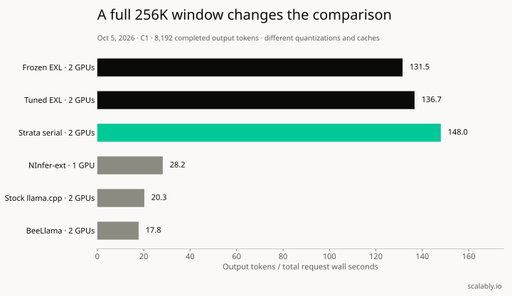
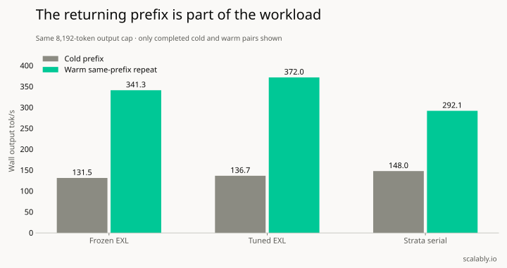
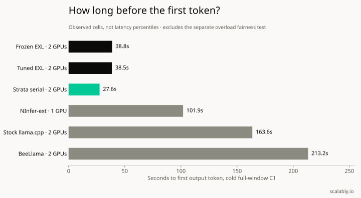

# Qwen Flash on two RTX 5090s: speed, cache and the queue

**Tuned ExLlamaV3 with TabbyAPI gave us the highest measured warm throughput in this Qwen3.8-Flash-Next campaign. It also made a short request wait 226 seconds under overload.** Both results belong in the decision.

I wanted to know how much useful serving capacity two RTX 5090s could provide for long agent sessions. A single tokens-per-second number wasn't enough. Returning history, thinking, tool calls, full output budgets and recovery all change what the machine can actually deliver.

So we rented an isolated dual-5090 host, kept our production rig unchanged, and tested frozen and tuned EXL configurations alongside [Strata](https://github.com/Niko1221/Strata), NInfer-ext, FreeToken, stock llama.cpp, ik_llama.cpp and BeeLlama. The campaign ended with a verified evidence archive and the rental destroyed. The complete per-engine matrix remains unfinished.

These are individual measured cells, without repeated-boot confidence intervals. This is a field report about serving. We didn't grade answers or establish equal model quality across quantizations.

## The comparison needs a workload attached

At a full 262,144-token window, Strata had the highest measured cold single-request wall rate. Tuned EXL had the highest completed warm repeat. At shorter contexts, batching and draft acceptance changed the picture again.

Our October 5, 2026 measurements used a Ryzen 9950X, two 32GB RTX 5090s and roughly 122GiB usable host RAM. The host stayed at 600W per GPU because the requested 500W limit was denied. That is a hardware boundary for reproduction, not a recommendation to run every rig at 600W.

Timing cells used temperature zero and an 8,192-token generation cap. Separate mixed cells used temperature 1.0, top_p 0.95 and top_k 20, with thinking off or medium. We kept actual reasoning and output counts. A request that stopped early wasn't relabelled as a full-length pass.

Engine and quantization changed together between several arms. NInfer and FreeToken used one GPU in their admitted configurations. We couldn't safely fit two default NInfer replicas in RAM. Those rows aren't equal-hardware or equal-fidelity engine comparisons.

## What a completed 256K request delivered

Every numeric row below completed 8,192 output tokens. Wall throughput divides those tokens by the entire request duration, including prefill. Warm means an unchanged-prefix repeat.

| Tested profile | GPUs | Cold wall tok/s | Warm wall tok/s | Cold first token |
|---|---:|---:|---:|---:|
| Frozen EXL3 2.50 / Quant8, final repeat | 2 | 131.5 | 341.3 | 38.8s |
| Tuned EXL3 2.50 / Quant8 | 2 | 136.7 | 372.0 | 38.5s |
| Strata serial GSQ IQ3_XXS / INT8 | 2 | 148.0 | 292.1 | 27.6s |
| NInfer-ext custom EXL3 3.5 / FP8 | 1 | 28.2 | Incomplete | 101.9s |
| Stock llama.cpp GSQ / q8_0 | 2 | 20.3 | Incomplete | 163.6s |
| BeeLlama GSQ / q8_0 | 2 | 17.8 | Incomplete | 213.2s |

Source: Scalably's October 5, 2026 isolated serving campaign; completed API usage rows, checked against the immutable final archive. Download the [reviewed chart data](full-window.csv).

Incomplete warm rows aren't zero throughput. The bounded measurement ended before a complete repeat was available. FreeToken and ik don't appear as numeric full-window results because neither produced an eligible completed row in this campaign.

The prompt budget was engine-specific. EXL used 253,952 prompt tokens plus 8,192 generated tokens. Strata's completed request used 253,943 plus 8,192 and eight reserved positions, leaving one position unused. Stock and Bee used 253,950 plus 8,192 and two reserved positions. These are actual server counts, not an estimated string length labelled "256K".

## Returning history changed the result

Preserving history is part of the serving configuration. During EXL tuning, our client removed an earlier empty thinking block when thinking was off. That changed the rendered prefix and reduced reuse from 16,128 cached tokens to 7,936.

On the same tuned configuration, correcting the replay raised warm C5 code throughput from about 896 to 1,071 aggregate wall tok/s. All five requests produced 8,192 tokens. We kept the earlier rows labelled with the history-framing defect.

That 1,071 result is a short-context code cell. It isn't the rate for every report, every thinking workload or every context length.

For the final frozen configuration, two-turn mixed workloads across five clients (ten completed turns) with arrivals and simulated tool waits completed at about 315 tok/s for sampled 128K traffic and 345 tok/s with medium thinking. The corresponding 100K cells reached about 344 and 381 tok/s. Those wall rates count the consumer's waiting time.

Our earlier [MoE versus dense inference benchmark](/blog/moe-vs-dense-llm-inference-vllm-benchmark-rtx-5090) covers a different model comparison. This campaign asks which Flash serving configuration can sustain the actual request shape.

## Five clients don't prove five active decodes

The tuned EXL configuration completed three overlapping full-window decodes at about 690 aggregate warm wall tok/s. Larger waves added queueing and could reduce throughput. We tracked decode interval overlap rather than treating an HTTP request count as GPU concurrency.

We searched beyond C5. C5 was a consumer target, not a ceiling. The useful result is the tested capacity frontier for a named configuration, with its latency and memory margin attached. We didn't exhaust every parameter combination.

## The 226-second request decides the production gate

Twelve long 100K requests completed under tuned EXL overload. An arriving short 4K request waited 226.34 seconds for its first token.

For interactive agents, that failure matters even when the long requests finish. A queue policy needs to bound long-request occupancy and give short work a predictable path. Separate capacity, admission limits and queue deadlines are options to test. None of those remedies was qualified in this run.

This chart shows cold C1 latency. The 226-second overload probe is a separate workload; it isn't a percentile derived from these bars.

We kept production unchanged. The existing [Qwen production field report](/blog/qwen3-8-27b-nvfp4-rtx-5090-production) describes that baseline. Flash throughput is evidence for another qualification step, not permission to replace it.

## Where the challengers broke

Strata completed the serial full-window comparison and actual tools, schema and thinking replay. Its native batch path repeatedly failed at C4/C5 in the tested build. A successful serial result doesn't clear a failed batching path.

NInfer-ext ran the custom 3.5-bit artifact on one GPU. Forced named tools and JSON schema returned explicit unsupported errors. Its 100K C5 wave completed three requests and failed two allocations.

FreeToken's admitted NVFP4 route was single-GPU offload. The available expert kernels rejected the two-GPU route. Tools and thinking replay passed; strict schema was unsupported. Long waves and mixed traffic remained partial.

Stock and Bee passed the required API checks and produced completed cold 256K requests. Four-slot variants hit memory gates; several long, warm and stress waves remained incomplete. ik initially crashed because the shared artifact contained a tensor storage type absent from its pinned loader. A separate lossless storage conversion passed decoded-value checks and admitted short inference, but added about 7.08GB to storage. That check doesn't establish identical GPU arithmetic or model quality.

We also caught a leftover NInfer process contaminating subsequent memory tests. Those attempts were marked invalid, cleanup was strengthened, and clean retries were retained. A failed isolation check cannot become a verdict about an engine's capacity.

## A cookbook you can use

Download the [charts, data and reproduction recipes](field-report-assets.zip), or read the [serving cookbook](COOKBOOK.md). It includes the measured EXL settings, context arithmetic, a benchmark row contract, isolation checks and a cutover/rollback checklist. Treat its configuration as a reproduction target for the tested versions and hardware.

Start with the actual consumer contract. An HTTP 200 or a process exit code doesn't prove a tool call or schema response is correct. Capture arguments, follow-up, historical reasoning and structured output. The [Claude Agent SDK guide](/blog/claude-agent-sdk-guide) explains the consumer side of that loop.

Before a production canary, the next useful test is an admission policy that passes the same short-request overload probe. Measure the queue, preserve returning history, and check completed outputs. The fast cell is only one row in that decision.

## Common questions

### Which engine was fastest at 256K?

In Scalably's October 5, 2026 completed C1 cells, Strata serial had the highest cold wall rate at 148.0 tok/s. Tuned EXL had the highest completed unchanged-prefix warm repeat at 372.0 tok/s. Different model quantizations and cache types prevent an equal-fidelity engine ranking.

### Can this configuration replace production?

It hasn't qualified for that. Tuned EXL made an arriving short request wait 226.34 seconds under long-request overload. The campaign didn't grade answer quality, and the complete per-engine matrix remains unfinished.

### Does 1,071 tok/s describe mixed agent traffic?

That number describes five short-context code requests, each completing 8,192 output tokens after the history-framing correction. The frozen configuration's two-turn mixed workloads measured about 315 to 381 wall tok/s, including arrivals and simulated tool waits.

## Sources and measurement boundary

All performance numbers above come from Scalably's isolated October 5, 2026 campaign. The downloadable CSV contains reviewed aggregate rows; private raw traces and operational receipts aren't published. The archive was checked again on October 6. Individual cells have no repeated-boot confidence intervals.

Implementation references, checked October 6, 2026: the [pinned EXL/Tabby recipe](https://github.com/adrienbrault/qwen3.8-flash-next-2x-rtx5090/tree/af2c4b841678a996632bf8e6bbd719aea66b823d) and [tested Strata source](https://github.com/Niko1221/Strata/tree/6f32ec070f23ced9f50e704d854d775da52591ab). Support and failure statements refer to those historical builds. They aren't claims about every current upstream version.
